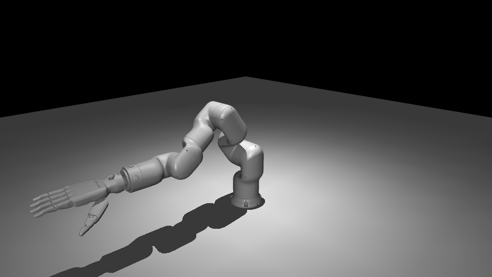
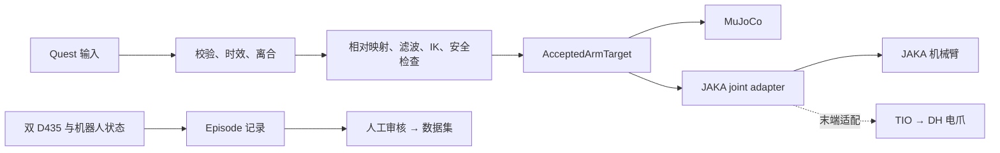

<div align="center">

# jaka-teleop

**JAKA Robot Teleoperation & Demonstration**

**从 Quest 输入到安全遥操作，再到可审核的机器人数据。**

JAKA · MuJoCo · Quest · RGB-D · RH56 / DH 适配

[首次安装](docs/setup/INSTALLATION.md) · [配置本机](docs/configuration/CONFIGURATION.md) · [遥操作](docs/operation/TELEOPERATION.md) · [采集数据](docs/data/DATA_COLLECTION.md) · [English](README.en.md)

</div>



> **真实运行的离线仿真预览**：使用仓库现有模型在 Thor 上加载、步进并通过 MuJoCo EGL 渲染。
> 图中末端是历史 RH56 模型；它不表示当前 DH 电爪、实物型号或真机遥操作已经验证。
> [模型来源](assets/README.md) · [运行仿真](docs/simulation/SIMULATION.md)

**现场实录**：[观看双 D435 同时采集预览（5 秒）](docs/media/dual-d435-check.mp4)。
视频左侧为工作区、右侧为用户确认的腕部相机。这是 camera-only 记录，不含机器人状态，也不是 DH 遥操作演示。
[本轮部署证据与未完成项](docs/setup/DEVICE_STATUS.md)。

本项目把输入校验、相对位姿映射、运动学求解、安全约束和数据记录串成一条可检查的链路。
可先在无设备环境中完成诊断与仿真，再逐项确认设备并启用物理适配器。
保留原有 RH56 工作流；当前 Thor 现场使用 DH 平行电爪，经 JAKA 末端 TIO 接入，用户提供的铭牌型号为 `PGE-50-26-O-S-M1`，接口与规格仍需核对。

## 最短起步：无需连接设备

```bash
git clone https://github.com/brVrzl/embodied-hand-lab.git
cd embodied-hand-lab
python3 -m venv .venv
.venv/bin/python -m pip install -e '.[simulation]'
.venv/bin/embodied-lab --help
.venv/bin/embodied-lab doctor
.venv/bin/embodied-lab sim smoke
```

需要 Python 3.10+。`doctor` 只盘点软件、配置及设备路径，不连接设备；`sim smoke` 加载并步进模型。
首次部署、系统依赖、JAKA native 构建和可选采集依赖见[完整安装教程](docs/setup/INSTALLATION.md)。
不需要为遥操作初始化训练子模块，也不需要重装 Thor 的系统驱动。

## 选择任务

| 我想做什么 | 从这里开始 | 验证边界 |
| --- | --- | --- |
| 在新机器上安装并自检 | [首次安装](docs/setup/INSTALLATION.md) | 离线 |
| 修改 IP、网卡、末端、相机和输出目录 | [配置说明](docs/configuration/CONFIGURATION.md) | 本地 YAML |
| 运行模型、回放已录输入 | [仿真与 replay](docs/simulation/SIMULATION.md) | 无执行器 |
| 确认 Quest 实际发送的数据 | [右 Touch](docs/motion_input/RIGHT_TOUCH.md) · [旧 HTS/CTRL](docs/motion_input/QUEST_CONTROLLER_TRANSPORT_HOST.md) | 仅输入接收 |
| 检查 JAKA，再进行遥操作 | [真机检查](docs/operation/REAL_ROBOT.md) → [遥操作](docs/operation/TELEOPERATION.md) | 分阶段、显式启用 |
| 用双相机采集、审核 episode | [采集流程](docs/data/DATA_COLLECTION.md) → [数据集](docs/data/DATASET.md) | 保留原始数据 |
| 训练或处理资产 | [ACT](docs/training/ACT.md) · [π0.5](docs/training/PI05.md) · [安装角色](docs/setup/INSTALLATION.md#按角色安装) | 独立依赖 |

## 一条控制链路



物理机械臂适配器消费同一份不可变目标，不跟随 MuJoCo `qpos`，也不再做一次 IK。
输入失效、限位、碰撞、watchdog 和清理逻辑属于运行约束；安装、帮助或 `doctor` 不会自动上电、使能或初始化电爪。
真机动作前请完成[安全检查](docs/safety/REAL_HARDWARE_SAFETY.md)。

## 硬件与验证范围

| 部分 | 仓库能力与当前边界 |
| --- | --- |
| MuJoCo | Thor 新用户 smoke 与 EGL 渲染通过；实物已确认 Mini2，8 组 SDK/MJCF 法兰 FK 计算一致；DH 工具几何仍待验收 |
| JAKA | 已核对 Mini2 / MiniCab、App 1.7.2.25 / 控制器 1.7.2_49；只读 5 秒/50 周期零 API 错误。未上电、未使能；有效 Servo/TIO 版本及 DH TCP/负载待验收 |
| Quest | 已收到真实 HTS/CTRL：20 秒 501 CTRL、397 hand、982 head，零解析错误、1 次 stale；CTRL 连接/跟踪标志均为 0，未收到 RTOUCH，右手 Touch 未通过 |
| DH 电爪 | [JAKA TIO 适配与确认步骤](docs/operation/DH_TIO.md)；铭牌为 PGE-50-26-O-S-M1；接线、供电与通信未验收，不复用 RH56 CH341 配置 |
| RealSense | 双 D435 RGB/RGB-D 各完成 5 秒并发采集，RGB 无 frame gap；一路 depth gap 为 2；workspace/wrist 角色已由现场画面与用户确认 |
| RH56 | 原工作流与历史数据保留；当前现场未连接，不作为部署必需设备 |

详见[文档索引](docs/README.md)、[当前能力](docs/CAPABILITIES.md)和[故障排查](docs/TROUBLESHOOTING.md)。

## 仓库导航

| 目录 | 内容 |
| --- | --- |
| `src/`、`native/` | 输入、控制、安全、设备适配与 native worker |
| `configs/` | 仿真、设备、采集和训练 YAML；本机值放忽略的 `configs/local/` |
| `tools/`、`scripts/` | 已维护的操作者入口及薄包装脚本 |
| `assets/` | 运动学、MuJoCo 模型与网格 |
| `docs/` | 安装、配置、操作和接口说明 |
| `training/`、`third_party/` | 训练边界、固定子模块与厂商 SDK |

数据、日志、模型权重和运行输出不随代码提交。第三方来源见 [THIRD_PARTY_NOTICES.md](THIRD_PARTY_NOTICES.md)。

Quest 的 Mac USB 调试、构建与安装见[Mac 交接清单](docs/setup/MAC_QUEST_HANDOFF.md)。
